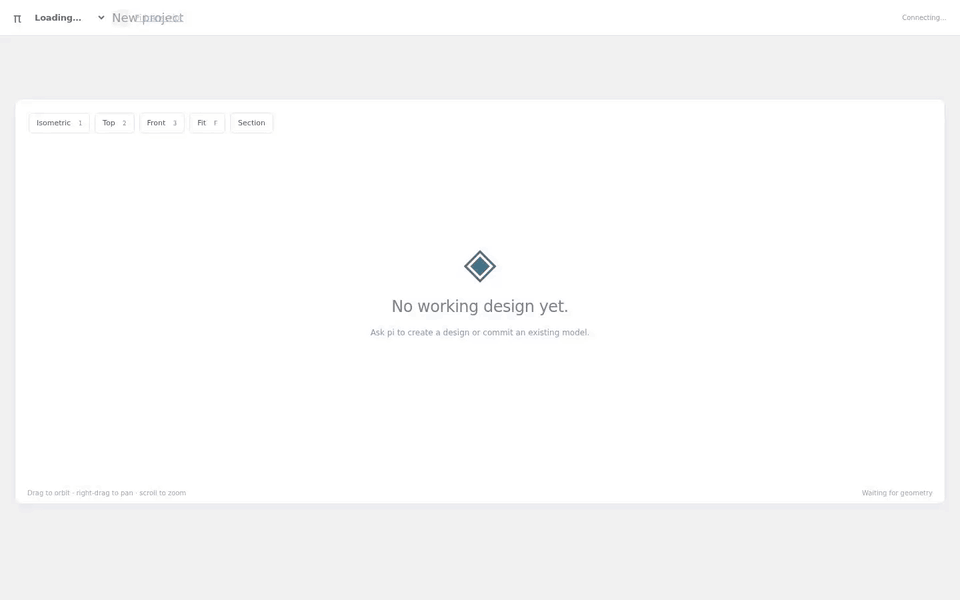

# 3d-pi

Self-hosted CAD with [pi](https://github.com/earendil-works/pi).
Describe and edit models in chat, inspect them in 3D, and download STEP, STL or
3MF files.

**[Get started ↓](#get-started)** · **[Install the chat studio](docs/container-deployment.md)** · **[Documentation](docs/README.md)**



*Real agent/CAD modelling. The modelling segment runs at 12× speed; the Make and
3MF download walkthrough was recorded separately. 72 seconds.*

## Get started

### Want the full conversational studio?

**[Follow the studio installation guide →](docs/container-deployment.md)**

You'll need **Linux, rootless Podman, Git and a supported model-provider account**.
The guide walks through building the images, configuring provider access, and
setting up the password-protected browser workspace. Images are built locally;
no prebuilt runtime is distributed.

Once installed, create a project and try:

> Make a small two-part box and lid. Inspect dimensions and clearances, show the
> result, and save the design with its source. Do not publish it.

### Just want to try the CAD viewer locally?

You'll need **Git, Node.js 24, Python 3.12 and [uv](https://docs.astral.sh/uv/)**.
On minimal Linux systems, install the native libraries listed in the
[Containerfile](Containerfile), including `libgl1`, `libglib2.0-0` and `libgomp1`.

```sh
git clone https://github.com/Brandl/3d-pi.git
cd 3d-pi
uv sync --locked
(cd web && npm ci && npm run build)
CAD_DATA_DIR="$PWD/.runtime/demo" uv run python -m cad.cli serve
```

Open **http://127.0.0.1:8765**. In another terminal, from the same repository:

```sh
uv run python -m cad.cli demo
```

The demo builds and publishes a teaching enclosure and separate lid into the
running service. Use the fresh demo data directory above, not an existing design
workspace. This setup provides the **CAD service and viewer, not browser chat**.
Keep it on loopback; use the studio guide for authenticated remote access.

## Features

- **Talk through your model.** Persistent conversations and separate source
  repositories keep projects organized.
- **See changes as they finish.** Live previews show passing builds, clearly
  marked as uncommitted intermediaries.
- **Inspect and refine.** Explore parts, dimensions, sections and assembly views.
- **Save with provenance.** Design commits link immutable geometry to matching
  Git source; viewing a preview doesn't save it.
- **Prepare outputs.** Export STEP, STL, 3MF and section DXF where supported, and
  attach named print/test sets with instructions.

The browser includes project history, reference uploads, transcript downloads and
mobile panes. Enter sends a message; Shift+Enter adds a newline.

## Already use pi locally?

With the CAD service running, start a configured pi installation in this
repository and trust `.pi/extensions/cad.ts` when prompted. Use `/reload` in an
existing session. Pi needs its own provider authentication; the geometry service
never needs model credentials.

Set `CAD_URL` to the correct **project-scoped loopback URL**, preserving any
`/projects/<id>` prefix. See the [CAD tool contracts](docs/agent-tools.md) and
[modeling guidance](AGENTS.md).

## Know the boundaries

This is experimental software for **one trusted owner**, not a multi-user sandbox.
The agent has shell and file tools in its workspace. Keep private CAD/agent APIs
private; expose only the authenticated gateway through HTTPS.

A passing build is **not proof of printability, fit, strength or safety**. Review
exports and physically test parts. Some specialized generators are mesh-only and
cannot provide exact STEP geometry or exact material sections.

Live previews aren't saved commits, and saved output sets may not match an
uncommitted preview. Stopping a turn does not roll back completed source changes,
builds or commits. Multi-step saving isn't an atomic transaction. Back up before
upgrades; APIs and storage may change.

## Documentation

- [Installation and provider setup](docs/container-deployment.md)
- [Studio, history and live previews](docs/studio-ui.md)
- [Projects and provenance](docs/projects.md)
- [Contributing and isolated tests](CONTRIBUTING.md)
- [Security and private reporting](SECURITY.md)
- [All documentation](docs/README.md)

## License

Original project material is [Apache-2.0](LICENSE). Dependencies, fonts and user
designs retain their own terms; see [third-party notices](THIRD_PARTY_NOTICES.md).
This is a source-only release. Redistributing a combined runtime or container
requires a separate GPL/LGPL and native-dependency compliance review.
